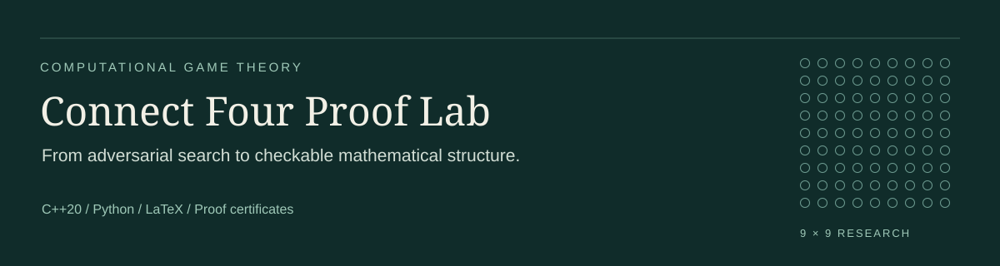

<p align="center"></p>

# Connect Four Proof Lab

**Structural combinatorics. Exact adversarial search. Checkable mathematical evidence.**

[](docs/local-verification-results.json)
[](https://github.com/rishitpradhan-gif/connect4-proof-lab/releases/tag/v0.1.0)
[](LICENSE)

A computational game-theory research project connecting mathematical strategy classification, certificate-producing algorithms, and exact search on **9×9 gravity Connect Four**.

The central question is demanding: can an opening outcome be established against **every** legal reply? This project develops tools for that standard of evidence, rather than treating a strong playing policy as a proof.

**[Read the 13-page research note](latex-development-note/output/pdf/main.pdf)** · **[Inspect the LaTeX proofs](latex-development-note/main.tex)** · **[Download the release](https://github.com/rishitpradhan-gif/connect4-proof-lab/releases/tag/v0.1.0)** · **[Reproduce the checks](#reproduce-the-evidence)**

> **Scope:** the empty 9×9 board remains unresolved in this project. The release establishes restricted-strategy results and certified position bounds; it does not claim a weak or ultra-weak solution, a literature-first result, or external peer review.

## Research contributions

### 1. A structural classification with an exact counting formula

The manuscript classifies **universally legal fixed response matchings**: pairings whose prescribed replies remain immediately playable under gravity, even when terminal wins are ignored. Isolated-column advancement reduces the family to vertical components and paired columns with a cross-prefix followed by vertical tails.

For odd width `w = 2m + 1` and odd height `h = 2n + 1`, after a fixed opening disc, the classification gives:

```text
N(w, h) = (2m − 1)!! · (n + 1)^m
N(9, 9) = 65,625 configurations per fixed opening
```

This turns an informal strategy idea into a precisely specified, countable mathematical object. [Full proof](latex-development-note/main.tex) · [Argument and scope](pairing-theorem.md)

### 2. A counterstrategy theorem extending beyond the original board

For **every nine-column board of odd height at least five**, every first-player strategy in that universally legal fixed-pairing family admits a second-player counterattack by **game ply 16**.

The 9×9 enumeration replays **328,125 configurations across five representative openings**. The manuscript audit additionally checks **42,525** configurations at height five and **134,400** at height seven. These are representative-opening configuration counts, not counts of distinct matching symmetry orbits.

The result identifies a structural limitation of a tempting proof shortcut. It does **not** exclude adaptive pairings or arbitrary first-player winning strategies. [Counterattack verifier](pairing-refutations.py) · [Extension audit](latex-development-note/audit_note.py)

### 3. A certificate-producing midgame theorem

A separate line-cover construction combines consecutive vertical pairs with cross-pairs of currently playable cells. It checks all **180 possible winning lines** and can return a mathematical nonloss certificate; a guaranteed responder four strengthens that to a forced-loss certificate for the player to move.

The independent verifier reconstructs **21 certificates**, including **nine forced losses**, on a collection of 100 independently solved endgames. Negative tests reject omitted pairs, illegal reply orientation, and unjustified winning claims. [Theorem](pairing-oracle.md) · [Independent checker](pairing-proof.py) · [Certificates](continuation/midgame-pairing-certificates.json)

### 4. Complementary exact-search implementations

- **Checkpointed WDL search:** an adapted generalized solver with full normalized 90-bit position-key comparisons stored in 128-bit integers, reflection, tactical pruning, and reusable subtree bounds.
- **Finite-horizon minimax:** an independent implementation that completed **27 plies** from the empty board. A depth-cutoff value of zero remains unresolved for the full game.
- **Depth-first proof-number search:** an AND/OR search for the proposition “P1 can force a win,” with sound conversion of cached WDL bounds into Boolean facts.

The final cache contains **16,650 distinct normalized position keys**, including **11,051 exact values** derived from compatible bounds. The merger detected no contradictions. These are subtree facts, not solved openings. [Search record](continuation/REPORT.md) · [Machine-readable results](continuation/results.json)

### 5. Research engineering that remains inspectable

The implementation checks more than search outcomes: independent array/bitboard comparisons, exact endgame references, legal-history replay, exhaustive small-board matching classification, full-key hash equality, malformed-certificate rejection, and all **18** turn-parity/WDL-bound conversion cases.

A hash-indexing repair improved discrimination between middle-column positions without relaxing key equality. Memory experiments also showed why larger tables can be counterproductive: the final default uses a **16 MiB** main search table and one concurrent job. The release preserves both useful results and unsuccessful experiments with their actual limits.

## What this project demonstrates

- **Mathematical abstraction:** formulate a restricted strategy space, prove its structure, and derive a counterstrategy with explicit quantifiers.
- **Algorithm design:** connect minimax, AND/OR proof search, matching-cover constraints, and strategic theorem leaves.
- **Systems judgment:** work with 128-bit bitboards, transposition identity, bounded working sets, cooperative cancellation, and persistent results.
- **Verification discipline:** make claims independently checkable and distinguish a certificate from a heuristic, a timeout, or a benchmark.
- **Research communication:** deliver readable theorem statements, executable witnesses, and a compiled LaTeX manuscript together.

## Reproduce the evidence

Requirements: **Python 3.10+** and a **C++20 compiler with `__uint128_t` support**, such as Clang or GCC on macOS/Linux. The core verification path uses only Python’s standard library. The exploratory `pairing.py` MILP experiment additionally requires NumPy/SciPy and is not needed for the released proofs.

```sh
git clone https://github.com/rishitpradhan-gif/connect4-proof-lab.git
cd connect4-proof-lab
python3 scripts/verify_release.py
```

The command builds the C++ programs and runs the independent certificate, endgame, classification, and manuscript audits in a temporary workspace. It does **not** launch a long opening search. Generated diagnostics go to `build/verification/`. A ready-to-enable [GitHub Actions workflow](automation/verify.yml) is included; this release does not present an inactive workflow as a passing CI run.

To run an explicitly bounded research experiment after verification:

```sh
# Boolean proof search, seeded with the released compatible bounds
./dfpn 60 5 continuation/merged-bounds.csv

# Finite-horizon exact search; a cutoff zero is not a full-game draw
./horizon 60
```

Time budgets are nominal wall-time targets; machine suspension or resource contention can delay cancellation. The long-running opening experiments in the evidence remain `UNKNOWN_TIMEOUT`.

The optional pairing oracle can be enabled with `ENABLE_PAIRING_ORACLE=1 sh build.sh`. The default search build leaves it disabled because the short opening benchmark did not establish a speed improvement.

## Navigate the repository

- [`latex-development-note/`](latex-development-note/) — self-contained LaTeX manuscript, compiled PDF, and finite-witness audit.
- [`certificate.py`](certificate.py), [`pairing-proof.py`](pairing-proof.py) — independent rule and certificate verification.
- [`pairing-refutations.py`](pairing-refutations.py) — exhaustive counterattack replay for the classified family.
- [`horizon.cpp`](horizon.cpp), [`dfpn.cpp`](dfpn.cpp) — complementary search implementations.
- [`engine/`](engine/) — attributed generalized-solver research fork.
- [`continuation/`](continuation/) — certificates, compatible cached bounds, final logs, and recorded limitations.
- [`RESEARCH_RECORD.md`](RESEARCH_RECORD.md) — original development record and research context.
- [`NOTICE`](NOTICE) — upstream provenance and assistance disclosure.

## Attribution and research integrity

A research project maintained by **Rishit Pradhan**, developed with **AI-assisted implementation, mathematical exploration, and proof drafting**. The released claims are tied to explicit hypotheses, inspectable source, and executable checks; “independent verification” refers to separate checking implementations, not external peer review.

The generalized exact engine is adapted from [Christophe Steininger’s `c4`](https://github.com/ChristopheSteininger/c4), baseline commit `fa27f186d2f1bf8e8fd61bfad63454c6e4b0431c`. Its license and credits to John Tromp and Pascal Pons are retained. The structural arguments and certificate tooling developed here are distinguished from that upstream baseline in the manuscript and [NOTICE](NOTICE).

**License:** AGPL-3.0; see [LICENSE](LICENSE). Cite the software using [CITATION.cff](CITATION.cff).
